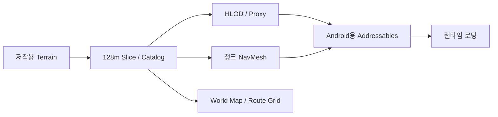

# 시스템 아키텍처

## 저작과 배포

런타임은 `MapSliceStreamer`의 Full/Proxy 우선순위 결정, Addressables 비동기 로드·해제, `MapSliceTerrainNeighbors`의 인접 Terrain 연결, `MapSliceRoutePlanner`의 지형 경로 탐색, `MapSliceWorldMapUI`의 지도 표시로 역할을 분리합니다.

**안전한 시작/빠른 이동:** 목표 지점의 Full Terrain과 Collider가 준비될 때까지 지면 배치를 기다립니다. 예상 경로와 NavMesh 검증 경로는 지도에서 구별합니다.

**공개 정책:** 전체 제작 파이프라인 코드는 비공개입니다.
