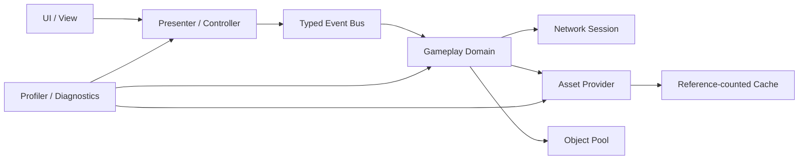
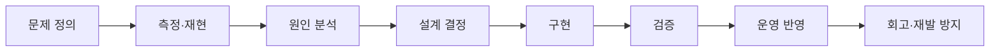

# 권상수 | Senior Unity Client Engineer

> **10년 이상의 Unity 기반 MMORPG·모바일 라이브 서비스 경험**  
> 신규 프로젝트 기반 설계부터 콘텐츠 개발, 성능 최적화, 서비스 안정화, 빌드 자동화까지 담당해 온 클라이언트 엔지니어입니다.

---

## 소개

Unity 기반 게임 클라이언트 개발자로서 MMORPG와 모바일 라이브 서비스 프로젝트를 장기간 개발·운영했습니다. 단순 기능 구현보다 오랫동안 안정적으로 운영할 수 있는 구조, 문제가 발생했을 때 원인을 추적할 수 있는 코드, 팀이 확장해도 유지보수 가능한 경계를 중요하게 생각합니다.

주요 경험은 다음과 같습니다.

- Unity 클라이언트 아키텍처 및 공통 시스템 설계
- 콘텐츠·UI·SDK 연동 전반 개발
- Addressables와 AssetBundle 생명주기 최적화
- 메모리 누수 및 GC Spike 분석·개선
- Draw Call, Shader, Particle, Overdraw 최적화
- TCP 재접속과 세션 복구 흐름 안정화
- Android·iOS 빌드 및 CI/CD 자동화
- 모바일 발열과 장시간 플레이 안정성 개선

> 이 저장소의 코드는 실제 업무 경험에서 얻은 설계 원칙을 바탕으로 포트폴리오용으로 재구성했습니다. 회사 소유 코드, 비공개 데이터, 서버 주소, 인증 정보, 상용 SDK 설정은 포함하지 않습니다.

---

## 핵심 역량

| 영역 | 주요 경험 |
|---|---|
| 클라이언트 아키텍처 | 기능 경계 분리, 이벤트 기반 구조, 라이프사이클 관리, 확장 가능한 공통 모듈 |
| 라이브 서비스 | 패치 안정성, 장애 분석, 재접속, 상태 복구, 운영 친화적 진단 로그 |
| 리소스 관리 | Addressables, AssetBundle, 캐시, 참조 카운트, 명시적 해제 정책 |
| 성능 최적화 | GC Alloc, 메모리 누수, Draw Call, Overdraw, Shader Variant, 발열 |
| UI·콘텐츠 | 이벤트 기반 UI, 던전·보스·전투 콘텐츠, Red Dot, 팝업·HUD 흐름 |
| 네트워크 | TCP 연결 상태 머신, 재시도, 인증 복구, 중복 요청 방지, 상태 동기화 |
| 배포 자동화 | Android·iOS 빌드, 환경 분리, 버전 정책, 산출물 및 로그 관리 |

---

## 대표 프로젝트

### 이라주접 — 이번 라그나로크의 주인공은 바로 저입니다만

- 신규 프로젝트에서 클라이언트 전반의 시스템과 콘텐츠를 담당
- UI, 콘텐츠, SDK, 리소스 관리, 성능 최적화까지 폭넓게 수행
- Addressables 구조 개선, GC Spike 제거, Draw Call 감소, 메모리 누수 해결
- TCP 재접속, CI/CD, Shader 및 모바일 발열 최적화 경험

### DK Mobile

- MMORPG 라이브 서비스 클라이언트 개발
- 콘텐츠·UI·SDK 연동 및 서비스 안정화
- 장시간 플레이 환경의 메모리와 성능 이슈 분석

### Call of Chaos Assemble

- 모바일 MMORPG 클라이언트 개발 및 운영 대응
- 공통 시스템, 콘텐츠, UI, 최적화 업무 수행

> 프로젝트별 세부 성과 수치는 공개 가능한 자료가 확인된 경우에만 기재합니다. 확인되지 않은 수치는 추정하거나 과장하지 않습니다.

---

## 기술 포트폴리오

### 설계와 아키텍처

- [시스템 아키텍처](docs/Architecture.md)
- [전투 및 Ability 시스템 설계](docs/CombatSystem.md)
- [이벤트 기반 UI 설계](docs/EventDrivenUI.md)

### 성능과 안정성

- [Addressables 및 리소스 생명주기](docs/Addressables.md)
- [메모리·GC 최적화](docs/MemoryOptimization.md)
- [렌더링·발열 최적화](docs/RenderingOptimization.md)
- [오브젝트 풀링 전략](docs/ObjectPooling.md)
- [통합 최적화 사례](docs/Optimization.md)

### 라이브 서비스와 배포

- [TCP 재접속 및 상태 복구](docs/TCPReconnect.md)
- [라이브 서비스 운영 원칙](docs/LiveService.md)
- [장애 대응과 진단](docs/IncidentResponse.md)

---

## 공개 코드 샘플

```text
samples/Runtime
├── Combat
│   └── AbilityCalculator.cs
├── Events
│   └── EventBus.cs
├── Optimization
│   └── YieldInstructionCache.cs
├── Pooling
│   └── ComponentPool.cs
└── Resources
    ├── IAssetProvider.cs
    └── ReferenceCountedAssetProvider.cs
```

모든 샘플에는 다음 기준을 적용했습니다.

- 주요 클래스와 메서드에 한글 XML 문서 주석 작성
- 구현 내용보다 설계 의도와 주의사항을 중심으로 설명
- Unity의 GC, 프레임 안정성, 라이프사이클 관점 반영
- 회사 코드나 프로젝트 고유 식별자를 제거한 독립 예제
- 코드와 연결되는 상세 기술 문서 제공

---

## 전체 아키텍처



### 설계 핵심

1. **UI는 게임 상태를 소유하지 않습니다.** 화면은 상태를 표시하고 입력을 명령으로 변환합니다.
2. **로드 기능에는 반드시 해제 정책이 함께 있어야 합니다.** 리소스 생명주기는 설계의 일부입니다.
3. **최적화는 측정 후 진행합니다.** Unity Profiler, Memory Profiler, Frame Debugger 결과를 기준으로 우선순위를 정합니다.
4. **네트워크 실패는 예외가 아니라 정상 흐름으로 다룹니다.** 재접속과 상태 복구를 명시적인 상태 머신으로 설계합니다.
5. **장시간 실행 안정성을 우선합니다.** 순간 최고 FPS보다 프레임 타임, 메모리, 발열의 지속 가능성을 중요하게 봅니다.

---

## 문제 해결 방식

모든 기술 문서는 다음 흐름을 따릅니다.


