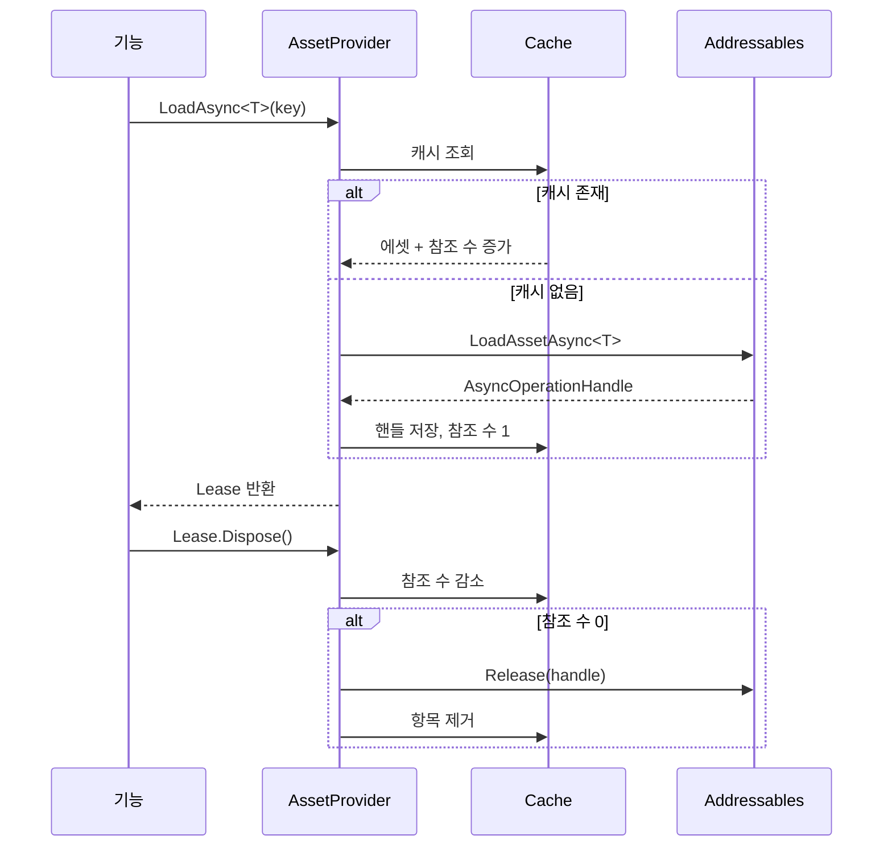

# Addressables 및 리소스 생명주기

## 1. 문제 배경

대규모 라이브 서비스 클라이언트는 UI, 몬스터, 이펙트, 사운드, 다운로드 콘텐츠를 런타임에 계속 로드합니다. 단순한 `LoadAsync` API만 제공하면 초기 구현은 빠르지만, 운영 중에는 다음 문제가 누적됩니다.

- 같은 키를 여러 시스템이 중복 로드
- 로드 성공 후 해제 주체가 불명확
- 실패한 핸들이 캐시에 남음
- 씬 이동 뒤에도 참조가 유지됨
- 인스턴스와 원본 에셋의 해제 방식 혼동
- 취소된 호출자와 공유 로드 작업의 소유권 충돌

## 2. 설계 목표

- 로드와 해제를 하나의 계약으로 묶는다.
- 동일 키의 중복 로드를 방지한다.
- 호출자가 소유권을 명확히 반환하도록 한다.
- 실패·취소·씬 전환 시 캐시 상태를 일관되게 유지한다.
- 환경별 원격 주소와 인증 정보를 코드에서 제거한다.

## 3. 제안 구조

## 4. 핵심 의사결정

### 에셋 대신 Lease 반환

에셋만 반환하면 해제를 잊기 쉽습니다. `IAssetLease<T>`는 호출자가 자원을 소유하고 있음을 명시하며, `Dispose` 시점에 참조 카운트를 감소시킵니다.

### 진행 중 로드의 단일화

동일한 키가 동시에 요청되면 하나의 비동기 작업을 공유해야 합니다. 그렇지 않으면 다운로드와 메모리 사용량이 중복됩니다. 단, 한 호출자의 취소가 공유 작업 전체를 취소하지 않도록 호출자 취소와 내부 작업 소유권을 구분해야 합니다.

### 실패 항목 제거

로드 실패 핸들이 캐시에 남으면 다음 호출도 즉시 실패하거나 잘못된 상태를 재사용합니다. 실패 결과는 캐시와 진행 중 테이블에서 반드시 제거합니다.

### 환경 설정 분리

원격 카탈로그 주소, CDN 경로, 인증 정보는 Addressables Profile이나 빌드 환경 설정에서 주입합니다. 소스 코드와 공개 저장소에 상용 주소를 직접 작성하지 않습니다.

## 5. 해제 정책

- 로드한 원본 에셋과 Instantiate한 인스턴스를 구분합니다.
- 화면·콘텐츠·씬 등 소유자 단위로 Lease를 관리합니다.
- 참조 수가 0이 된 시점에만 내부 핸들을 해제합니다.
- 씬 종료 시 남은 Lease를 진단 로그로 확인합니다.
- 풀링 객체는 인스턴스 해제와 에셋 핸들 해제를 분리합니다.

## 6. 메모리 누수 점검

1. 특정 화면을 반복 진입·이탈합니다.
2. Memory Profiler Snapshot을 진입 전·후로 비교합니다.
3. Addressables Event Viewer 또는 Diagnostic Event로 핸들 상태를 확인합니다.
4. 씬 참조, Static 컬렉션, 이벤트 구독, 풀의 보유 객체를 함께 조사합니다.
5. 에셋을 해제했더라도 다른 Unity 오브젝트가 참조 중인지 확인합니다.

## 7. GC와 프레임 안정성

리소스 로딩 완료 시점에 대량의 콜백과 컬렉션 변환이 몰리면 GC Spike가 발생할 수 있습니다. 완료 처리에서 LINQ, 문자열 조합, 불필요한 배열 복사를 줄이고, 많은 인스턴스 생성은 프레임에 분산합니다.

## 8. 운영 체크리스트

- 모든 성공 로드에 명시적인 반환 경로가 있는가?
- 실패·취소된 작업이 캐시에서 제거되는가?
- 동일 키의 동시 로드가 단일화되는가?
- 씬 이동 후 이전 씬 소유 Lease가 남지 않는가?
- 카탈로그와 원격 주소가 환경별로 분리되는가?
- 인스턴스와 원본 에셋의 해제 API가 혼동되지 않는가?
- 변경 전후 Profiler Snapshot이 보관되는가?

## 9. 관련 코드

- `samples/Runtime/Resources/IAssetProvider.cs`
- `samples/Runtime/Resources/ReferenceCountedAssetProvider.cs`
