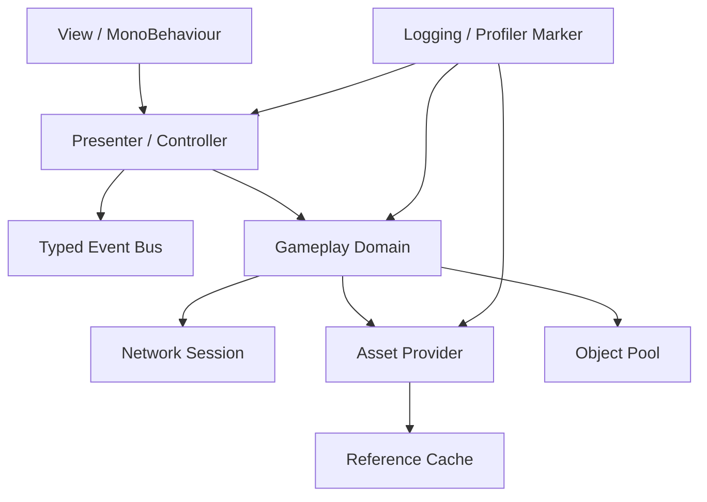
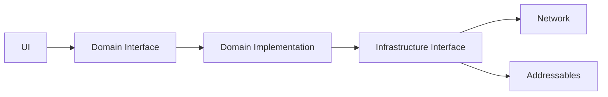

# 시스템 아키텍처

## 1. 목표

라이브 서비스 게임의 클라이언트는 기능이 동작하는 것만으로 충분하지 않습니다. 콘텐츠가 계속 추가되고, 서버 규격과 SDK가 바뀌며, 네트워크 단절과 장시간 플레이가 반복되는 환경에서도 수정 범위를 통제할 수 있어야 합니다.

이 문서의 목표는 다음과 같습니다.

- UI, 게임 규칙, 인프라의 책임을 분리한다.
- 리소스와 이벤트 구독의 생명주기를 명확히 한다.
- 재접속 후 상태를 안전하게 복구한다.
- 진단과 성능 측정을 공통 기능으로 제공한다.
- 새로운 콘텐츠가 기존 시스템을 침범하지 않도록 경계를 만든다.

## 2. 전체 구조

## 3. 계층별 책임

### Presentation

- 화면 표시와 사용자 입력 처리
- 도메인 상태를 읽어 화면을 갱신
- 비즈니스 규칙을 직접 소유하지 않음
- `OnEnable`/`OnDisable` 또는 명시적 소유 객체를 통해 구독 생명주기 관리

### Domain

- 전투 능력치, 던전 진행, 보상 조건, 상태 전이 등 게임 규칙 담당
- Unity 오브젝트 참조를 최소화해 테스트 가능성 확보
- 서버에서 받은 권위 상태와 클라이언트 예측 상태를 구분

### Infrastructure

- 네트워크 연결, 인증, 재접속, 요청 관리
- Addressables 로드·캐시·해제
- 오브젝트 풀, 저장, 플랫폼 SDK, 진단 로그
- 환경별 설정과 비밀 정보 분리

## 4. 생명주기 설계

라이브 서비스에서 가장 자주 발생하는 문제는 생성보다 해제에서 시작합니다.

- 이벤트 구독은 구독 토큰 또는 `Dispose`로 해제합니다.
- 로드한 리소스는 소유자 단위로 반환합니다.
- 풀에서 꺼낸 객체는 상태 초기화 계약을 실행합니다.
- 화면 전환 시 비동기 작업의 취소와 완료 경합을 처리합니다.
- 재접속 중에는 중복 요청을 막고, 복구 이후 권위 상태로 다시 그립니다.

## 5. 의존성 방향

UI가 네트워크나 Addressables를 직접 호출하면 기능이 빠르게 얽힙니다. Presentation은 Domain 인터페이스에 의존하고, Domain은 Infrastructure의 추상화에 의존하도록 구성합니다.

## 6. 라이브 서비스에서 얻는 효과

- 콘텐츠 추가 시 기존 UI와 네트워크 코드를 동시에 수정하는 상황을 줄입니다.
- 재접속 완료 후 Domain 상태를 먼저 복구한 뒤 UI를 일괄 갱신할 수 있습니다.
- 리소스 로딩과 해제 정책을 독립적으로 테스트할 수 있습니다.
- Profiler Marker와 구조화 로그를 공통 계층에서 일관되게 남길 수 있습니다.
- 장애 발생 시 어느 계층에서 문제가 시작됐는지 추적하기 쉬워집니다.

## 7. 위험과 대응

|         위험           |                       대응                 |
|------------------------|-------------------------------------------|
| 이벤트 핸들러 중복 등록 | 구독 토큰, 명시적 해제, 중복 검사           |
| 리소스 메모리 누수      | 참조 카운트, 소유자 단위 해제, 씬 종료 감사 |
| 재접속 폭주            | Single-flight 상태 머신과 Backoff          |
| UI 상태 불일치         | 서버 권위 상태 복구 후 전체 Refresh         |

## 8. 검증 기준

- 기능 테스트뿐 아니라 장시간 반복 진입·이탈 테스트를 수행합니다.
- 씬 전환 전후 메모리 스냅샷을 비교합니다.
- 재접속 중 요청 중복 여부를 로그로 확인합니다.
- UI가 Domain과 다른 상태를 소유하고 있지 않은지 코드 리뷰합니다.
- 기능별 Profiler Marker를 통해 회귀를 추적합니다.

## 9. 관련 코드

- `samples/Runtime/Events/EventBus.cs`
- `samples/Runtime/Resources/ReferenceCountedAssetProvider.cs`
- `samples/Runtime/Pooling/ComponentPool.cs`
