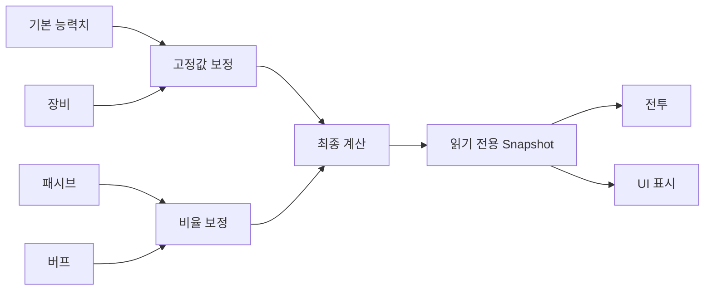

# 전투 및 Ability 시스템 설계

## 1. 목표

능력치 계산은 장비, 버프, 패시브, 스킬, 콘텐츠 보정 등 여러 입력이 누적되는 영역입니다. UI와 전투 코드 곳곳에서 계산하면 규칙이 중복되고 결과가 달라집니다. 계산 책임을 순수한 도메인 로직으로 모아 테스트와 확장을 쉽게 만드는 것이 목표입니다.

## 2. 계산 흐름

## 3. 설계 원칙

- 계산기는 Unity 오브젝트에 의존하지 않는 순수 코드로 작성합니다.
- 입력 컬렉션은 읽기 전용 인터페이스로 전달합니다.
- 계산 결과는 변경 가능한 원본 Dictionary 대신 Snapshot으로 반환합니다.
- 고정값 보정과 비율 보정을 분리해 규칙을 명확하게 합니다.
- 표시용 반올림과 실제 전투 계산 정밀도를 구분합니다.

## 4. 운영 시 고려사항

- 서버와 클라이언트의 계산 규칙 버전을 맞춥니다.
- 상태 변경 시 전체 재계산이 필요한지 부분 갱신이 가능한지 결정합니다.
- 빈번한 계산은 임시 컬렉션 할당을 줄이고 버퍼를 재사용합니다.
- 능력치 키 문자열은 상수·Enum·ID 테이블 등으로 관리해 오타를 줄입니다.
- 최종 수치뿐 아니라 어떤 보정이 반영됐는지 진단할 수 있어야 합니다.

## 5. 테스트 예시

- 기본값만 존재하는 경우
- 고정값과 비율 보정이 함께 존재하는 경우
- 동일 능력치에 여러 Modifier가 누적되는 경우
- 존재하지 않는 능력치 조회
- 음수·상한·하한 정책
- 서버 결과와 클라이언트 결과 비교

## 6. 관련 코드

- `samples/Runtime/Combat/AbilityCalculator.cs`
