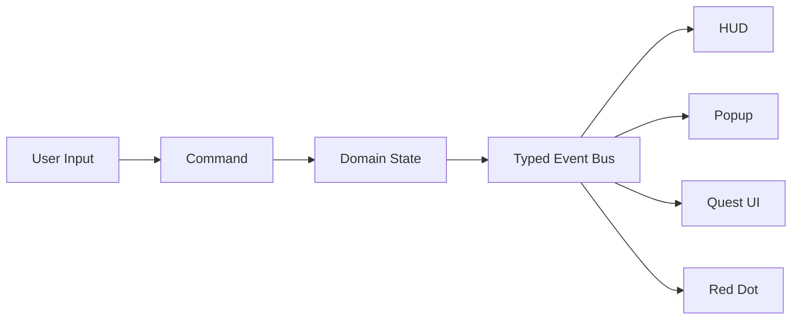

# 이벤트 기반 UI 설계

## 1. 문제

UI가 서로 직접 참조하면 팝업, HUD, 인벤토리, 퀘스트, Red Dot 시스템이 강하게 결합됩니다. 화면 하나를 수정했는데 여러 프리팹과 매니저가 함께 변경되고, 씬 전환 뒤 남은 이벤트 구독 때문에 중복 호출이 발생할 수 있습니다.

## 2. 구조

## 3. 설계 원칙

- 이벤트는 이미 발생한 사실을 표현합니다.
- 명령은 사용자의 의도를 표현합니다.
- UI는 이벤트를 구독해 화면만 갱신합니다.
- 중요한 게임 상태는 UI 내부에 중복 저장하지 않습니다.
- 구독 결과를 `IDisposable`로 반환해 소유자가 해제합니다.

## 4. 이벤트 버스 사용 시 주의점

이벤트 버스는 결합도를 낮추지만 남용하면 흐름을 찾기 어려워집니다.

- 이벤트 이름과 Payload를 구체적으로 작성합니다.
- 전역 이벤트와 기능 내부 이벤트를 구분합니다.
- 호출 순서에 의존하는 로직은 이벤트 대신 명시적인 오케스트레이션을 사용합니다.
- 예외가 한 구독자에서 발생해 전체 전파를 막지 않도록 정책을 정합니다.
- 고빈도 이벤트는 배열 복사와 Delegate 호출 비용을 측정합니다.

## 5. 생명주기

- 화면 활성화 시 구독하고 비활성화 또는 Dispose 시 해제합니다.
- 자기 자신을 해제하는 구독자가 있어도 안전하도록 게시 시 Snapshot을 사용합니다.
- 중복 등록 여부를 진단할 수 있는 개발용 도구를 둡니다.
- 씬 변경 뒤 남은 구독자를 탐지합니다.

## 6. 관련 코드

- `samples/Runtime/Events/EventBus.cs`
