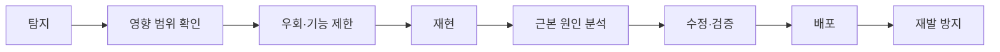

# 장애 대응과 진단

## 대응 흐름

## 우선순위

1. 사용자 데이터와 결제 안전성
2. 접속 불가·진행 불가
3. 크래시와 데이터 불일치
4. 심각한 성능 저하
5. 시각·편의 문제

## 진단 정보

빌드 버전, 플랫폼, 기기, 콘텐츠 ID, 상태 전이, 네트워크 종료 이유, 마지막 정상 요청, Addressables 키, 오류 식별자를 구조화해 기록합니다. 민감 정보는 마스킹합니다.
