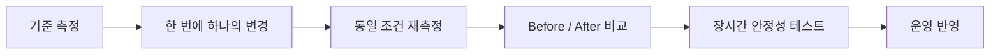

# 통합 성능 최적화 사례

## 1. 원칙

최적화는 감이 아니라 측정 결과를 기준으로 진행합니다. 먼저 재현 조건과 목표 기기를 고정하고, CPU·GPU·메모리·네트워크 중 실제 병목이 어디인지 구분합니다.

## 2. 분석 도구

- Unity Profiler: CPU Usage, Timeline, Rendering, GC Alloc
- Memory Profiler: Managed Heap, Native Object, Texture, Mesh, Duplicate
- Frame Debugger: Draw Call, Pass, Material, Batch 상태
- Android GPU Inspector·Xcode Instruments: GPU와 발열 분석
- 자체 구조화 로그: 재접속, 로드, 화면 전환, 콘텐츠 상태 추적

## 3. GC Spike 제거

- Update 루프의 LINQ와 문자열 조합 제거
- 반복 생성되는 `WaitForSeconds` 캐시
- 임시 List·Array 할당 최소화
- Delegate·Closure 할당이 빈번한 경로 점검
- Instantiate/Destroy 집중 구간에 풀링 적용

## 4. 메모리 누수 해결

- 이벤트 구독 해제 누락 확인
- Addressables 핸들과 인스턴스 해제 구분
- Static 컬렉션과 Singleton 보유 참조 점검
- 화면 반복 진입 후 Snapshot 비교
- 풀 크기 상한과 정리 정책 설정

## 5. 렌더링 최적화

- Material 공유와 Atlas로 Batch 가능성 개선
- 파티클 수, Overdraw, 투명 UI 계층 감소
- Shader Variant와 불필요한 Pass 정리
- LOD와 이펙트 품질 단계 제공
- FPS보다 Frame Time 분포와 발열 지속성을 함께 확인

## 6. 검증 방식

수치가 공개 가능한 경우에만 포트폴리오에 기재합니다. 수치가 없을 때는 개선 방법과 검증 절차를 중심으로 설명합니다.
