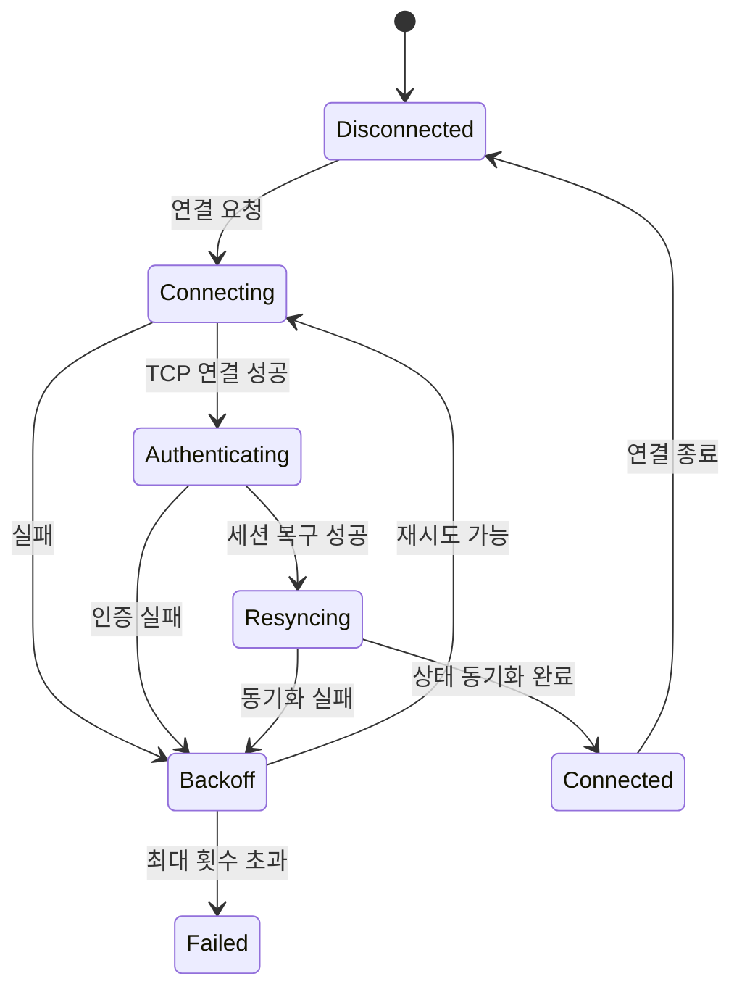

# TCP 재접속 및 상태 복구

## 1. 목표

모바일 환경에서는 앱 전환, Wi-Fi·LTE 변경, 일시적인 음영 지역로 연결이 끊길 수 있습니다. 재접속은 단순히 Socket을 다시 여는 작업이 아니라 인증과 게임 상태를 복구하는 전체 흐름입니다.

## 2. 상태 머신

## 3. 핵심 설계

- 동시에 하나의 재접속 작업만 실행합니다.
- 재시도 간격은 지수 Backoff와 상한을 둡니다.
- 인증 토큰 만료와 네트워크 단절을 구분합니다.
- 재접속 중 신규 요청은 대기·취소·거절 정책을 명확히 합니다.
- 요청 ID와 응답 ID를 관리해 중복 처리하지 않습니다.
- 연결 복구 후 서버 권위 상태로 UI와 콘텐츠를 다시 갱신합니다.

## 4. 중복 요청 방지

재접속 직전 전송된 요청이 서버에서 처리됐지만 응답만 받지 못한 경우가 있습니다. 따라서 단순 재전송은 중복 구매나 보상 요청을 만들 수 있습니다.

- 멱등 요청 ID 사용
- 마지막 처리 Sequence 확인
- 서버가 지원하는 경우 Resume Token 활용
- 복구 전 대기 큐의 요청 상태 재검증

## 5. 사용자 경험

- 짧은 단절은 화면을 막지 않고 자동 복구합니다.
- 복구 시간이 길어지면 명확한 연결 상태를 표시합니다.
- 재접속 실패 시 로그인 화면 또는 안전한 상태로 이동합니다.
- 복구 중 입력이 실제로 반영됐는지 혼동하지 않도록 UI를 제한합니다.

## 6. 관측성

연결 상태 전이, 종료 이유, 재시도 횟수, 인증 결과, 동기화 시간, 마지막 정상 패킷을 기록합니다. 단, 토큰과 민감한 Payload는 로그에 남기지 않습니다.
